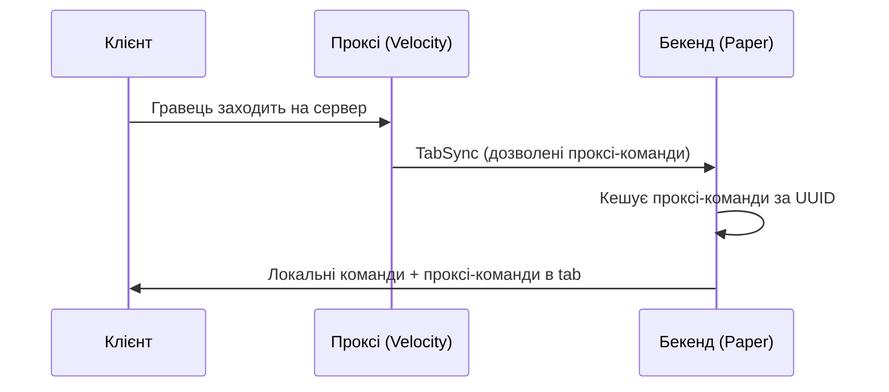

# Робота в мережі

Коли CommandGuard стоїть і на проксі Velocity, і на бекенд-серверах Spigot/Paper,
дві версії працюють над **різними наборами команд** і доповнюють одна одну.
Проксі надсилає бекенду свій дозволений список команд через plugin messaging
(**TabSync**), щоб гравець бачив спільний tab-complete: і команди бекенда, і
команди проксі.

## Хто за що відповідає

- **Проксі (Velocity)** керує лише **своїми** командами (зареєстрованими на самому
  Velocity: `/hub`, `/server`, `/skin`...).
- **Бекенд (Spigot)** керує своїми командами (`/home`, `/spawn`...).
- **TabSync** додає проксі-команди поверх команд бекенда в автодоповненні гравця.

Напрямок синхронізації — завжди **проксі → бекенд**. Бекенд нічого не надсилає на
проксі.

## Як працює TabSync



## Налаштування

### 1. Конфіг проксі (`config.yml` на Velocity)

```yaml
is_network: true

tab:
  default:
    priority: 0
    commands:
      - "/hub"
      - "/server"
      - "/skin"
```

### 2. Конфіг бекенда (`config.yml` на Spigot)

```yaml
is_network: true

tab:
  default:
    priority: 0
    commands: []   # проксі-команди додаються автоматично через TabSync
```

:::info
Кожен рівень керує своїми командами незалежно. Локальні tab-групи бекенда й далі
діють для його власних команд — TabSync лише робить проксі-команди видимими в
автодоповненні на бекенді.
:::

## Оновлення після зміни конфігу

Після редагування конфігу проксі:

```
/cgv reload
```

Ця команда перечитує конфіг **і** одразу надсилає TabSync усім онлайн-гравцям —
перезаходити не потрібно.

Після редагування конфігу бекенда:

```
/cg reload
```

## Примусове оновлення одного гравця

```
/cgv updategroup <гравець>
/cg updategroup <гравець>
```
