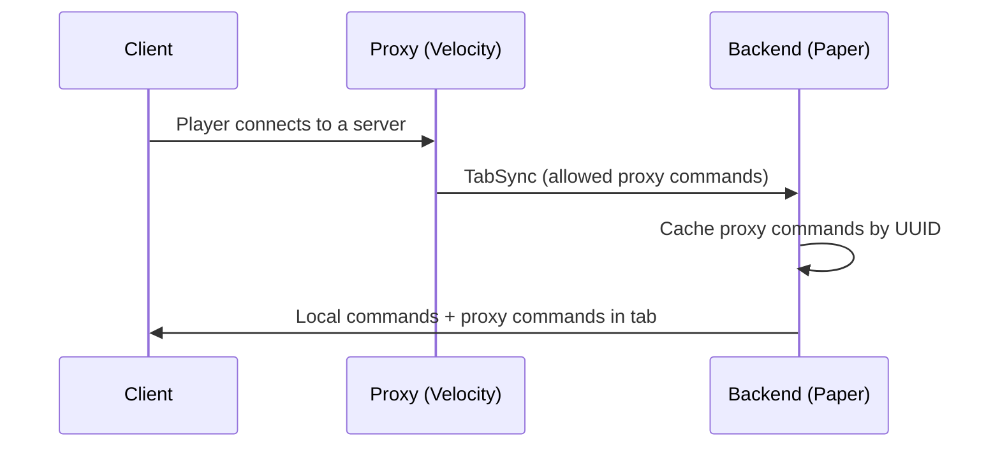

# Cross-Server Setup

When CommandGuard is installed on both the Velocity proxy and the Spigot/Paper
backends, the two versions work over **different sets of commands** and complement
each other. The proxy pushes its allowed command list to the backend via plugin
messaging (**TabSync**) so players see a unified tab-complete list: both backend
and proxy commands.

## Who handles what

- **Proxy (Velocity)** manages **its own** commands only (registered on Velocity
  itself: `/hub`, `/server`, `/skin`...).
- **Backend (Spigot)** manages its own commands (`/home`, `/spawn`...).
- **TabSync** adds proxy commands on top of backend commands in the player's tab
  list.

The sync direction is always **proxy → backend**. The backend sends nothing to the
proxy.

## How TabSync works



## Setup

### 1. Proxy config (`config.yml` on Velocity)

```yaml
is_network: true

tab:
  default:
    priority: 0
    commands:
      - "/hub"
      - "/server"
      - "/skin"
```

### 2. Backend config (`config.yml` on Spigot)

```yaml
is_network: true

tab:
  default:
    priority: 0
    commands: []   # proxy commands are added automatically via TabSync
```

:::info
Each layer manages its own commands independently. The backend's local tab groups
still apply to its own commands — TabSync only makes proxy commands visible in the
backend's autocomplete.
:::

## Updating after a config change

After editing the proxy config:

```
/cgv reload
```

This reloads the config **and** pushes TabSync to all online players immediately —
no relog needed.

After editing the backend config:

```
/cg reload
```

## Force-update a single player

```
/cgv updategroup <player>
/cg updategroup <player>
```
