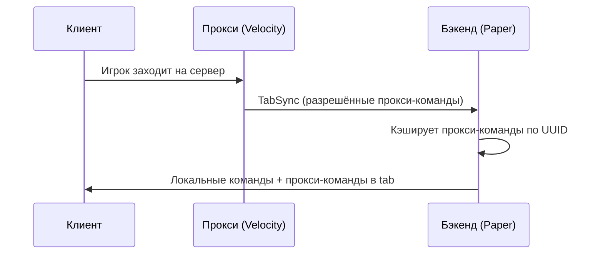

# Работа в сети

Когда CommandGuard стоит и на прокси Velocity, и на бэкенд-серверах Spigot/Paper,
две версии работают над **разными наборами команд** и дополняют друг друга. Прокси
отправляет бэкенду свой разрешённый список команд через plugin messaging
(**TabSync**), чтобы игрок видел общий tab-complete: и команды бэкенда, и команды
прокси.

## Кто за что отвечает

- **Прокси (Velocity)** управляет только **своими** командами (зарегистрированными
  на самом Velocity: `/hub`, `/server`, `/skin`...).
- **Бэкенд (Spigot)** управляет своими командами (`/home`, `/spawn`...).
- **TabSync** добавляет прокси-команды поверх команд бэкенда в автодополнении
  игрока.

Направление синхронизации — всегда **прокси → бэкенд**. Бэкенд ничего не отправляет
на прокси.

## Как работает TabSync



## Настройка

### 1. Конфиг прокси (`config.yml` на Velocity)

```yaml
is_network: true

tab:
  default:
    priority: 0
    commands:
      - "/hub"
      - "/server"
      - "/skin"
```

### 2. Конфиг бэкенда (`config.yml` на Spigot)

```yaml
is_network: true

tab:
  default:
    priority: 0
    commands: []   # прокси-команды добавляются автоматически через TabSync
```

:::info
Каждый уровень управляет своими командами независимо. Локальные tab-группы бэкенда
по-прежнему действуют для его собственных команд — TabSync лишь делает прокси-команды
видимыми в автодополнении на бэкенде.
:::

## Обновление после изменения конфига

После редактирования конфига прокси:

```
/cgv reload
```

Эта команда перечитывает конфиг **и** сразу отправляет TabSync всем онлайн-игрокам —
перезаходить не нужно.

После редактирования конфига бэкенда:

```
/cg reload
```

## Принудительное обновление одного игрока

```
/cgv updategroup <игрок>
/cg updategroup <игрок>
```
